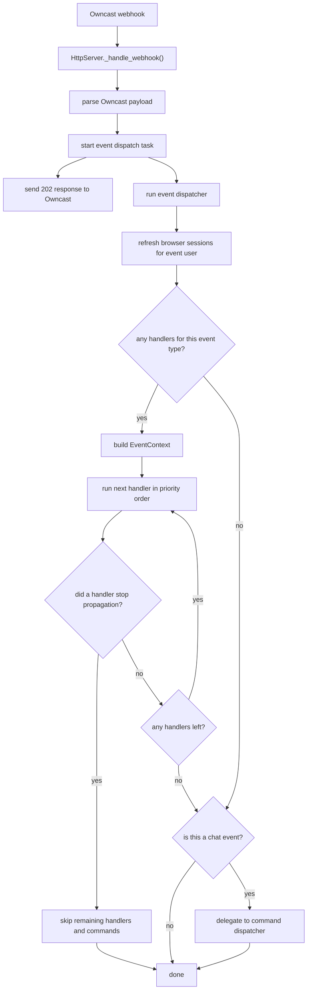
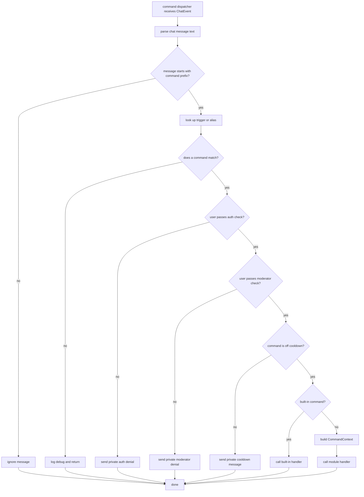
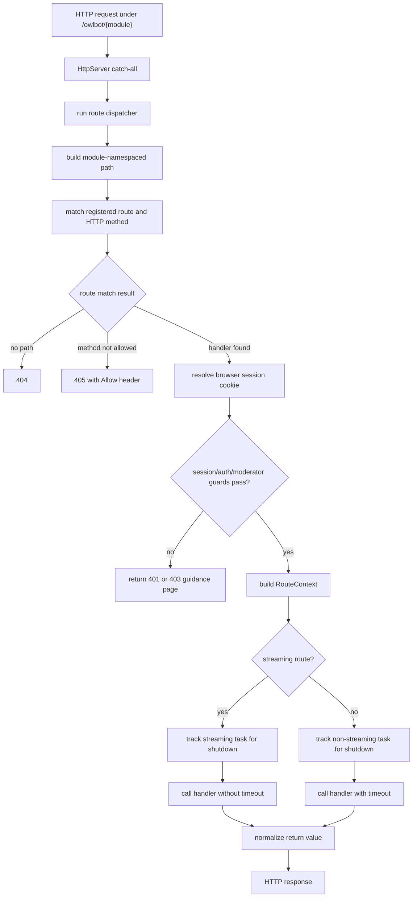

# Registries

This package contains Owlbot's internal registration and dispatch code for
events, commands, and HTTP routes. The module-facing API lives in `owlbot/api/`;
the classes here are the runtime layer that stores registrations, builds handler
contexts, and calls module code.

The goal of this README is to document the flows and contracts that maintainers
need to preserve. Function-level details should stay in docstrings or tests.

## Files

- `events.py`: event handler registration, priority ordering, propagation
  control, and command dispatch for chat events.
- `commands.py`: chat command registration, parsing, permission checks,
  cooldowns, aliases, and built-in commands.
- `routes.py`: module HTTP route registration, path matching, route guards,
  response handling, and shutdown tracking for active route handlers.
- `__init__.py`: convenience exports for the registry, dispatcher, and
  module-scoped wrapper classes.

Each domain has the same basic shape: decorators mark static handlers, module
wrappers support dynamic registration, registries store metadata, and dispatchers
build the right context before invoking the handler.

```mermaid
flowchart LR
    Decorator["@on_* decorator marks a handler"] --> Loader["ModuleLoader scans imported module"]
    Dynamic["module code registers handlers at runtime"] -->|ctx.commands/events/routes.register()| Dispatcher["domain dispatcher"]
    Loader --> Dispatcher
    Dispatcher --> Registry["domain registry stores metadata"]
    Registry --> Dispatcher
    Dispatcher --> Context["build Event/Command/Route context"]
    Context --> Handler["call module handler"]
```

## Core Contracts

Registry state is owned by a `ModuleLoader` instance. It is not global state.
This lets multiple Owlbot instances run in one Python process without sharing
registered handlers, cooldowns, or active route tasks.

Every registered command, event handler, and route belongs to a `module_name`.
The module-scoped wrappers (`ModuleCommands`, `ModuleEvents`, and
`ModuleRoutes`) automatically supply that name for dynamic registration and keep
modules from unregistering other modules' commands or event handlers.

During unload, `ModuleLoader._cleanup_module()` calls `unregister_by_module()`
on all three dispatchers so a module's registrations are removed together.

Dispatchers isolate module failures. A bad handler should be logged and handled
without bringing down the bot or corrupting the rest of the dispatch cycle.

## Event Dispatch

Events start as Owncast webhooks. `HttpServer._handle_webhook()` parses the
payload, starts event dispatch in a background task, and returns `202` to
Owncast immediately.



Event handlers run sequentially by priority. Higher priority runs first, and
handlers with the same priority run in registration order.

Event handlers receive `EventContext`, which contains the parsed event, the
owning `ModuleContext`, propagation state, and a session URL builder for events
that carry a user. Each handler gets its own context, but all handlers in one
dispatch share the same propagation state. Calling `ctx.stop_propagation()`
stops later event handlers and also prevents command dispatch for `CHAT` events.

For events that carry a `user`, dispatch refreshes any matching browser sessions
and exposes `ctx.session_url_for(path)`. Events without a user do not have a
session URL builder.

Handler exceptions and timeouts are logged. They do not stop later handlers
unless propagation was explicitly stopped.

## Command Dispatch

Commands are reached through event dispatch. The webhook server never calls the
command dispatcher directly. After `CHAT` event handlers finish, and only if
propagation was not stopped, `EventDispatcher` delegates to
`CommandDispatcher.dispatch()`.



Command parsing uses the configured prefix. The first token after the prefix is
the trigger, and the rest of the message becomes `ctx.args`. Matching is
case-insensitive.

Command names and aliases are globally unique across modules and built-ins.
Aliases resolve to the canonical command name, so handlers see the same
`ctx.command` no matter which trigger the user typed. Unregistering a command
also removes its aliases.

Permission checks and cooldowns happen before the handler runs. Cooldowns are
global per command, not per user, and the cooldown is claimed before invoking
the handler so concurrent messages cannot all slip through together.

Built-in commands use a smaller internal handler signature and do not receive a
`ModuleContext`. The default built-ins are:

- `about`: sends version and loaded-module information;
- `connect`: hides the invoking chat line and sends a one-time browser connect
  link to that client.

Module command handlers receive `CommandContext`, which contains the parsed
command, the original `ChatEvent`, the invoking user, and the owning
`ModuleContext`, plus a session URL builder for protected module routes.

Command handler exceptions and timeouts are logged and swallowed.

## Route Dispatch

`HttpServer` owns the aiohttp catch-all routes under `/owlbot/{module_name}` and
`/owlbot/{module_name}/{path:.*}`. Requests under those paths are delegated to
`RouteDispatcher.dispatch()`, which matches them against module-registered
routes.



Routes are automatically namespaced as `/owlbot/<module_name>/<path>`. They
support aiohttp-style path parameters such as `{id}` and `{id:regex}`. Route
matching is registration ordered, so broad patterns can shadow later, more
specific patterns.

Multiple handlers can share the same path when their HTTP methods do not
overlap. If a path matches but the method does not, dispatch returns `405` with
an `Allow` header. If no path matches, dispatch returns `404`.

Route guards run before the handler. `requires_session` needs any valid Owlbot
browser session; `requires_authenticated` and `requires_moderator` require an
authenticated user or moderator session. Any guard failure returns before the
handler is called. Missing or stale sessions return the shared connect guidance
page, while authentication and moderator failures return `403` guidance pages.

Route handlers receive `RouteContext`, which contains the aiohttp request, the
owning `ModuleContext`, captured path parameters, and the resolved browser
session if one exists.

Route handlers can return `None` for `204 No Content`, `web.StreamResponse`
objects as-is, or `dict[str, Any]` for JSON responses. Unsupported return
values, uncaught exceptions, and non-streaming timeouts become `500`. Raised
aiohttp `web.HTTPException` values pass through to aiohttp.

Streaming routes set `streaming=True`. They bypass the normal handler timeout
and are tracked separately so shutdown can cancel long-lived connections. During
shutdown, non-streaming handlers are allowed to finish first; streaming handlers
are cancelled afterward.

## Test Map

Start with these tests when changing registry behavior:

- `tests/test_events.py`: event registration, priority, propagation, command
  handoff, event contexts, and `ModuleEvents` ownership.
- `tests/test_commands.py`: command parsing, aliases, conflicts, permissions,
  cooldowns, built-ins, command contexts, and `ModuleCommands` ownership.
- `tests/test_routes.py`: route matching, method conflicts, guards, response
  handling, streaming, shutdown draining, route contexts, and `ModuleRoutes`
  ownership.
- `tests/test_module_loader.py`: loader wiring for shared session state and the
  configured command prefix.
- `tests/builtin_modules/`: integration-style coverage for built-in modules that
  use registry APIs through `ModuleContext`.
